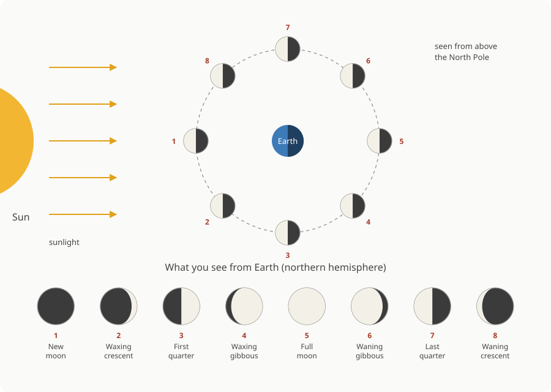

How the clock works
===================

.. brief:
   Reader: anyone curious about the clock.
   They already know: school maths and physics (angles, cosine, the solar system).
   After this page they can: explain why the clock's Moon looks the way it does.
   Page type: explanation.

This page explains the idea behind the clock without code. If you
know what a cosine is and that the Earth goes round the Sun, you have
all the background you need. Each section ends with a link to the
page that does the same thing properly, with the maths.

.. figure:: _static/photos/sim_home.webp
   :alt: The clock's home screen: a waning gibbous Moon on a black round screen, with the time in large digits
   :width: 60%
   :align: center

   The home screen. The Moon is drawn by the clock itself, not loaded
   from a picture.

Why the Moon has phases
-----------------------

You can see the idea with a lamp and a ball. In a dark room, hold a
light-coloured ball at arm's length, with one lamp on the far side of
the room. Turn slowly on the spot so the ball goes round your head.
Facing the lamp, you see the ball's dark side. With the lamp behind you
(keep your head out of its light), the ball is fully lit. In between
you see a half or a crescent. You are the Earth, the ball is the Moon,
and the lamp is the Sun.

The Sun always lights exactly half of the Moon, the half that faces
it. What changes during a month is how much of that lit half we can
see from Earth.

The Moon goes round the Earth once every 29.53 days, measured from one
new moon to the next. When it sits between us and the Sun (position 1
in the figure), the lit half faces away from us and we see nothing:
a new moon. A week later we look at it from the side and see half of
the lit half: first quarter. When the Earth is between the Sun and the
Moon (position 5), we see the whole lit half: full moon. Then the
pattern runs backwards.

   Top: the Moon at eight points of its orbit, seen from far above the
   North Pole. Its left half is always lit. Bottom: what you see from
   the northern hemisphere at each point. From the southern hemisphere
   the shapes are mirrored left to right.

Phases are not the Earth's shadow. That is a common mix-up. The Earth's
shadow falls on the Moon only during a lunar eclipse, which happens at
most a few times a year, always at full moon. On every other day the dark part of the
Moon is its own night side, facing away from the Sun.

The number of days since the last new moon is called the Moon's
*age*. A clock that only showed phases could stop here: work out the
age, then pick one of a few pictures. This clock goes further.

Why the Moon looks tilted where you live
----------------------------------------

Pictures of the Moon in books usually show it with north at the top.
That is not how you see it in the sky. A crescent seen near the
equator at sunset lies on its back like a bowl. The same crescent seen
from northern Europe stands more upright. Over a night the Moon also
turns as it rises, crosses the sky and sets.

The tilt depends on where you stand and on the time. The clock knows
both: you choose a time zone such as ``Europe/Berlin``, and each zone
in the list carries the position of a reference city. The clock turns
the Moon on the screen to match what someone in that city would see.
:doc:`The observer view <implementation/observer-view>` has the
formula.

Why the Moon wobbles
--------------------

The Moon always turns the same face towards us, but not perfectly.
Its orbit is an ellipse, and it is slightly tilted, so over a month we
see a little way round each edge, and over the top and bottom. This
rocking is called *libration*. Over time it lets us see about 59 % of
the Moon's surface, not just 50 %. The clock includes it, so the
craters near the edge move slightly from day to day, as they do in
the real sky. :doc:`Geometry and ephemeris <science/geometry>`
explains how.

How a small chip draws the Moon
-------------------------------

The clock runs on a microcontroller: a small, cheap computer on a
single chip, about as fast as a desktop PC from the late 1990s. It has
no internet connection while it draws. Four ingredients go into each
picture.

**Two maps of the Moon.** NASA's Lunar Reconnaissance Orbiter has
photographed and measured the whole Moon. The clock stores two maps
made from that data, the way a globe stores a map of the Earth:

- a *brightness map* (the "albedo"), which says how light or dark the
  rock is at each place. The dark "seas" are old lava; the bright
  highlands are older rock;
- a *height map*, measured with a laser from orbit, which says how
  high the ground is at each place.

**Where the Sun and the Earth are.** Astronomers have published
formulas that give the positions of the Sun, the Earth and the Moon
for any date, to good accuracy. The clock evaluates those formulas
itself. From them it gets two directions, as seen from the Moon: the
direction of the Sun, and the direction of the Earth.

**How much light each point catches.** For every pixel of the round
picture, the clock works out which point on the Moon that pixel shows.
Then it asks how directly the Sun shines on that point. Light that
hits the ground head-on is brightest. Light that arrives at an angle
is spread over more ground, so each piece gets less. The rule is
*Lambert's cosine law*:

.. math::

   \text{brightness} = \text{albedo} \times \cos(\text{angle between the Sun and the vertical})

With the Sun straight overhead the angle is 0° and the cosine is 1,
full brightness. At 60° the cosine is 0.5, half brightness. At 90° the
Sun is on the horizon and the point is on the line between day and
night, which astronomers call the *terminator*. Beyond 90° it is
night.

**Mountains and craters.** On a perfect ball the terminator would be a
smooth curve. On the real Moon a crater wall that faces the Sun
catches more light than the flat ground next to it, and the far wall
sits in shadow. The clock uses the height map to work out how each
small patch of ground is tilted, and puts that tilt into the cosine
law. That is what gives the ragged, shadowed edge you see in a
telescope. :doc:`The lighting model <science/lighting>` takes you
through it step by step.

The night side
--------------

The part of the Moon that faces away from the Sun is not completely
black. Sunlight bounces off the Earth and lights it very faintly; this
is called *earthshine*. On a small screen the true level would be
almost invisible, so the clock lights the night side a little more
than nature does, as if a weak lamp stood exactly opposite the Sun.
Craters stay recognisable, and the brightest night-side pixel is still
only about 51 out of 255. :doc:`The dark side <science/darkside>`
explains the choice.

Speed
-----

Working through every pixel takes time. On the main board a full
400 × 400 pixel Moon takes about 1.3 seconds. The Moon changes slowly,
so the clock draws a fresh one once an hour and shows it whole, in one
step, so you never see half an old Moon next to half a new one. While
it works, the ring of the seconds display fills up as a progress bar.
:doc:`Performance <verification/performance>` has the measurements.

How we know it is right
-----------------------

NASA's Scientific Visualization Studio publishes a computer-rendered
image of the Moon for every hour of the year, made with large
computers and the same lunar maps. An automated test, the *image
gate*, runs the clock's drawing code on a PC for 32 moments across the
year and compares each result with NASA's image pixel by pixel.

On the scale of 0 (black) to 255 (white), the clock's Moon differs
from NASA's by 6.68 brightness steps on average. The test fails if any
single picture differs by more than 12 steps on average. :doc:`The image gate
<verification/image-gate>` shows the pictures side by side.

Keeping time
------------

The clock sets itself from the internet over Wi-Fi, using the Network
Time Protocol (NTP), and then switches the radio off to save power.
Between updates the main board counts time with a separate
real-time-clock chip; the other two boards keep time with the main
chip's own low-power timer. :doc:`The clock and sleep machine <implementation/clock-sleep>`
describes the details.

Where to go next
----------------

- To build one: :doc:`Getting started <getting-started>`.
- To learn the controls: :doc:`Using the clock <using-the-clock>`.
- To see the full model with equations: :doc:`The science
  <science/index>`.
- For words you have not met before: :doc:`the glossary <glossary>`.
