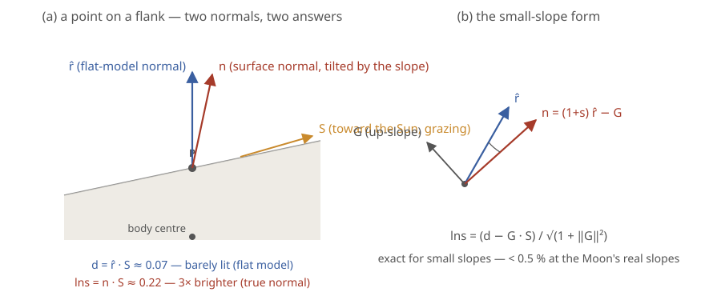

The lighting model
==================

.. brief:
   Reader: a developer or technical reader who has read the geometry page.
   They already know: the S, E, right and up vectors; the dot product; Lambert's cosine law in outline.
   After this page they can: follow the per-pixel bake in moon_bake.c from screen offset to output byte, and say why the relief term and the gradient cache exist.
   Page type: explanation.

The lighting model answers one question per pixel: how much sunlight reaches this point of the surface, toward the viewer?
:doc:`How the clock works <../how-it-works>` gave the short answer: albedo times the cosine of the Sun's angle, with the height map tilting each patch.
This page gives the full model and the code from ``moon_bake.c``.
The result has to make the terminator (the line between day and night) look like the ragged, mountain-shadowed edge in NASA's frames, not a smooth arc.
That edge is what separates a physically rendered moon from a shaded circle.

The short version
-----------------

The picture on the panel is not a stored photo.
The device computes it pixel by pixel, and every pixel goes through the same five steps:

1. Find the point.
   Work out which spot on the Moon's ball the pixel shows.
2. Ask how directly the Sun hits it, as if the Moon were a perfect ball with no mountains.
3. Correct for the local tilt.
   The real surface has mountains and crater walls.
   A patch tilted toward the Sun catches more light than the ball says; one tilted away catches less, and can sit in a shadow the ball model knows nothing about.
   The tilt comes from a terrain height map measured by lunar orbiters.
4. Multiply by the paint.
   A sunlit basalt sea is still darker than a sunlit highland; the albedo (reflectivity) map supplies that.
5. Map to display values.
   A calibrated brightness table converts the raw brightness so it matches NASA's rendered frames, and a faint Earth-reflected glow (*earthshine*) goes onto the night side.

The four input vectors (the Sun direction :math:`\mathbf{S}`, the Earth direction :math:`\mathbf{E}`, and the screen's :math:`\mathbf{right}`/:math:`\mathbf{up}` axes) come from :doc:`the geometry <geometry>`.

Vocabulary
----------

Seven terms carry the page.
The :doc:`glossary <../glossary>` has the full definitions.

- **Terminator**: the day/night boundary on the visible disk.
- **Albedo**: how much light the surface material reflects.
  A dark lava sea has low albedo, a bright highland rock high.
  It is the Moon's paint, independent of lighting.
- **Surface normal**: an arrow standing straight up out of the surface at a point.
  How much sunlight a patch catches depends on the angle between this arrow and the Sun's direction.
- **Dot product**: ``A · B`` of two unit arrows equals the cosine of the angle between them: ``1`` when they point the same way, ``0`` at right angles, negative when they point apart.
  It answers "how directly does the surface face the Sun?" with three multiplies and two adds.
- **Lambert** (Lambert's cosine law): a surface's brightness is proportional to how directly it faces the light, ``L = max(0, cos(angle to the Sun))``.
  Surfaces facing away are dark.
- **DEM / gradient**: the *Digital Elevation Model* is a map of surface heights in metres, here laser-altimeter data from the LOLA instrument.
  Its *gradient* at a point is the pair of numbers saying how fast the ground rises going east and going north: the local slope.
- **LUT**: a *look-up table*, here an array of 256 numbers.
  Entry ``n`` says "turn raw value ``n`` into display brightness ``T[n]``", so one array read replaces a curve evaluation.

From pixel to sphere: the orthographic view
-------------------------------------------

The pixel grid is a flat shadow of the ball.
A pixel's position in the disk, measured from the centre in units of the disk radius, says which point of the sphere sits behind it.
The farther from the centre, the more the surface has curved away from the viewer.
The only geometry needed is Pythagoras.

The camera is 384,400 km away and the Moon's radius is 1,737 km, so for our purposes the camera is at infinity and the view is *orthographic*.
Every screen pixel :math:`(x, y)` maps to a unit direction :math:`\hat{\mathbf{r}}` on the Moon's base sphere (the sphere without relief), built from the camera basis:

.. math::

   \hat{\mathbf{r}} = u\,\mathbf{right} + v\,\mathbf{up} + w\,\mathbf{E},
   \qquad
   w = \sqrt{1 - (u^2 + v^2)}

:math:`u` and :math:`v` are the pixel's offsets from the disk centre in units of the disk radius.
Outside the unit circle (:math:`u^2 + v^2 > 1`) the pixel is off the disk and black.
The :math:`w` term is the part of the direction along the line of sight; it is what makes the surface curve toward the viewer at the limb.

.. figure:: ../_graphs/lighting_ortho.svg
   :alt: Two panels. (a) The pixel's screen offset (u, v) plus w times E form the base direction. (b) A side view in which w equals cos(phi), 1 at the disk centre and 0 at the limb.
   :figclass: align-center
   :width: 100%

   The orthographic view.
   (a) The in-page part of the base direction is the 2-D offset :math:`(u, v)`; the third component :math:`w\,\mathbf{E}` points at the viewer, out of the page.
   (b) Side view: the pixel sits off the line of sight by the angle :math:`\varphi`, and :math:`w = \cos\varphi` is 1 at the disk centre and 0 at the limb.

The :math:`w` term pulls :math:`\hat{\mathbf{r}}` back toward the camera and makes the limb curve.
In the C core, per pixel:

.. code-block:: c
   :caption: components/moon/core/moon_bake.c (bake_px, the base direction)

   float u = ((float)x - c->cx) / c->radius;
   float r2 = u * u + c->v * c->v;
   if (r2 > 1.0f) { c->row[x] = 0; return; }
   float w = sqrtf(1.0f - r2);
   /* Base direction, body frame (pole = +z). */
   float rx = u * g->right[0] + c->v * g->up[0] + w * g->E[0];
   float ry = u * g->right[1] + c->v * g->up[1] + w * g->E[1];
   float rz = u * g->right[2] + c->v * g->up[2] + w * g->E[2];
   float d  = rx * g->S[0] + ry * g->S[1] + rz * g->S[2];

The dot :math:`d = \hat{\mathbf{r}}\cdot\mathbf{S}` is the *base-sphere* sub-solar cosine: how directly the perfect ball faces the Sun at this point.
On a perfect sphere with no relief the terminator is exactly :math:`d = 0`, and the Lambert term would be :math:`\max(0, d)`.
That cheap model is wrong in the place that matters most, the terminator.

Why the flat model fails at the terminator
------------------------------------------

The Moon has mountains.
At the day/night line the Sun skims the surface almost sideways.
A ridge a few kilometres tall casts a long shadow into the valley behind it: the ridge's sunlit face is bright, and the valley a few kilometres away is dark.
A crater's inner wall can catch sunlight while its floor stays dark.
These effects are largest where the Sun grazes the surface.
That is why NASA's frames show a jagged terminator that follows crater rims and mountain chains, and a smooth cosine terminator shows none of it.
A model that ignores the terrain paints those spots the wrong colour, and the eye reads the result as a "cartoon moon".

The fix gives every surface point its own normal, displaced from the base-sphere normal by the local slope, and takes the Lambert with that normal.
This is the *displaced-normal* model.

.. figure:: ../_graphs/lighting_terminator.svg
   :alt: Cross-section of a ridge at the terminator, with a straight blue boundary for the flat model and a jagged red true boundary. Point M is in the ridge's shadow; point N is on a lit inner wall beyond the flat line.
   :figclass: align-center
   :width: 78%

   Why the flat model fails, in one cross-section.
   The flat model's terminator is the straight line :math:`d = 0` (blue); the true lit/dark boundary (red) is jagged.
   M is on the day side of the flat line but in the ridge's cast shadow: the flat model calls it lit, the true surface is dark.
   N is on the night side of the flat line, but its inner wall turns toward the Sun: the flat model calls it black, the true surface is lit.

The displaced-normal Lambert
----------------------------

Instead of asking how the ball faces the Sun, the model asks how the tilted ground faces it.
The ground's tilt at each point comes from the terrain height map, as two slope numbers per map cell: how fast the ground rises eastward and how fast northward.
Tilting the "straight up" arrow by that slope and taking the dot product with the Sun gives the brightness.

For a height field :math:`h` on the sphere, a point's true surface normal is the base-sphere normal displaced by the height gradient.
Let :math:`\mathbf{G}` be the gradient of :math:`h/R` (height in metres divided by the Moon's radius, so dimensionless) in the local east–north tangent basis.
The exact radial-displacement normal is

.. math::

   \mathbf{N} = \mathrm{normalize}\big((1 + s)\,\hat{\mathbf{r}} - \mathbf{G}\big),
   \qquad s = h/R

and the Lambert is :math:`\mathbf{N}\cdot\mathbf{S}`.
Working out the normalization turns the dot into a ratio that needs no explicit normalization.
For the small slopes the Moon has (<< 0.3 rad), this *small-slope form* is accurate to under 0.5%:

.. math::

   \mathbf{N}\cdot\mathbf{S} = \frac{\hat{\mathbf{r}}\cdot\mathbf{S} - \mathbf{G}\cdot\mathbf{S}}{\sqrt{1 + \lVert\mathbf{G}\rVert^2}}
   = \frac{d - \mathbf{G}\cdot\mathbf{S}}{\sqrt{1 + |\mathbf{G}|^2}}

Piece by piece: ``d`` is the ball's answer from the previous section.
``G · S`` subtracts the extra (or missing) Sun-facing that the slope provides.
The square root rescales the tilted arrow back to unit length.
It barely moves at real slopes, which is why the approximation is safe.

The C core calls the unclipped quantity :math:`lns`:

.. code-block:: c
   :caption: components/moon/core/moon_bake.c (the displaced-normal term)

   float gs = glon * east_s + glat * north_s;
   lns = (d - gs) / sqrtf(1.0f + glon * glon + glat * glat);

The lit-side Lambert is the clip:

.. math::

   L = \mathrm{clip}(lns,\, 0,\, 1)

The code keeps the unclipped :math:`lns` because the dark side (:doc:`the dark side <darkside>`) needs :math:`\mathrm{clip}(-lns, 0, 1)`: the same surface lit from the anti-solar direction.

   The displaced-normal construction.
   (a) On a flank that slopes toward the grazing Sun, the radial normal reads :math:`d \approx 0.07` (barely lit) and the slope-tilted normal reads :math:`lns \approx 0.22`.
   (b) The small-slope form :math:`lns = (d - \mathbf{G}\cdot\mathbf{S}) / \sqrt{1 + \lVert\mathbf{G}\rVert^2}`.

In panel (a) the tilted normal gives three times the brightness of the flat one.
That difference is the ridge-shadow contrast the flat model cannot see.

The bake applies the model over the whole lit disk, not only near the terminator.
Mountain shadows reach well into the lit side, and the full-disk model is what matches NASA's terminator contrast.
(A band-only variant was measured and rejected; see :doc:`/project/history`.)

The relief DEM and its gradient cache
-------------------------------------

All the terrain knowledge lives in one height map from lunar orbiters.
The bake does not need the heights themselves, only how steep the ground is, as two numbers per point.
Steepness depends only on the height map, not on the Moon's phase.
So the device computes it once for every map cell at boot, packs the two slopes into one 16-bit word, and the bake reads one word per pixel.
On the S3 that brings the frame time from about 3.3 s to about 1.3 s.

The height data is the LOLA (Lunar Orbiter Laser Altimeter) DEM.
The clock boards store it as a 2048×1024 int8 equirectangular map; the knob's is the halved 1024×512 (the per-board sizes are in :doc:`the moon constants <../reference/moon-consts>`).
Each cell is the LOLA height quantized to 8 bits over a fixed range in metres:

.. code-block:: c
   :caption: components/moon/generated/<board>/moon_consts.h (the relief DEM)

   // LOLA height quantized to int8 over [MOON_DEM_MIN, MOON_DEM_MAX] meters:
   // code = round((h - MIN) / (MAX - MIN) * MOON_DEM_STEPS) - 128.
   #define MOON_DEM_W      2048
   #define MOON_DEM_H      1024
   #define MOON_DEM_STEPS  254
   #define MOON_DEM_MIN_M  -8518.19921875
   #define MOON_DEM_MAX_M  10416.568359375

The naive way to get the gradient is a 4-neighbour central difference per pixel.
That is six dependent loads per pixel from the S3's external RAM (PSRAM, pseudo-static RAM), and on the S3 (the Waveshare ESP32-S3-Touch-AMOLED-1.75) it measured about 3.3 s per frame.
The core instead precomputes the gradient once per DEM cell into a packed cache (:doc:`the C core <../implementation/core-c>`):

.. code-block:: c
   :caption: components/moon/core/moon_bake.c (relief_cell, the cache entry)

   float dhlon = ((float)row_m[c + 1] - (float)row_m[c - 1]) * mps;  // east-west slope
   float dhlat = ((float)row_n[c]     - (float)row_s[c])     * mps;  // north-south slope
   int8_t qn = slope_q(dhlon * inv_glon), qt = slope_q(dhlat * inv_glat);
   gpack[c] = (uint16_t)((uint16_t)(uint8_t)qn | ((uint16_t)(uint8_t)qt << 8));

What the code does:

1. The east–west slope starts as the height one cell east minus the height one cell west; north–south likewise.
2. ``mps`` (metres per step) converts the stored bytes to metres; the full height range is spread over 254 quantization steps.
3. The height difference is divided by the ground distance the cells cover on the sphere.
   ``inv_glon``/``inv_glat`` are those reciprocals.
   The east–west one carries the ``rho`` = cos(lat) factor, because a cell of longitude narrows toward the poles, so the same height difference means a steeper slope.
4. Each slope is rounded to one signed byte (quantization step 0.003 rad).
5. The two bytes are packed, low and high, into one 16-bit word.

The bake then does one 16-bit load per pixel for the relief instead of six dependent byte loads.
Per-pixel PSRAM traffic drops from 6 to 3 (1 albedo byte, 1 packed 2-byte gradient, and the texture-coordinate maths), and the frame time on the S3 drops to about 1.3 s.
The quantization step (0.003 rad) costs less than 0.3% of :math:`L`, and :doc:`the image gate <../verification/image-gate>` re-checks it after any change.

The slopes are a pure function of the DEM cell (the four-neighbour height differences), so the cache does not depend on the phase.
The device builds it once at boot and reuses it for every frame, which keeps the orbit re-bakes cheap.

The tangent basis
-----------------

"Slope east" and "slope north" only mean something once you draw an east arrow and a north arrow lying flat on the sphere at that point.
The core does not compute the point's latitude and longitude and call trigonometry on them.
It builds the two arrows directly from the direction vector it already has, with one square root.

The gradient :math:`\mathbf{G}` lives in the local east–north tangent plane of the unit sphere.
The two unit vectors come from the base direction :math:`\hat{\mathbf{r}} = (rx, ry, rz)`, with no longitude/latitude transcendentals:

.. math::

   \text{east}  = \frac{(-ry,\; rx,\; 0)}{\rho}, \qquad
   \text{north} = \frac{(-rz\,rx,\; -rz\,ry,\; \rho)}{\rho}, \qquad
   \rho = \sqrt{rx^2 + ry^2} = \cos(\text{lat})

Only their dot products with :math:`\mathbf{S}` are needed, and the core computes those directly:

.. code-block:: c
   :caption: components/moon/core/moon_bake.c (tangent dots with the Sun)

   float rho = sqrtf(rx * rx + ry * ry);   /* = cos(lat) */
   if (rho < 1e-4f) rho = 1e-4f;
   float inv = 1.0f / rho;
   float east_s  = (-ry * g->S[0] + rx * g->S[1]) * inv;
   float north_s = (-rz * rx * g->S[0] - rz * ry * g->S[1] + rho * g->S[2]) * inv;

The :math:`\rho < 10^{-4}` guard covers the polar cap, where the east–north basis degenerates.
There :math:`lns \to 0` anyway, so the guard changes nothing visible.

Albedo, nearest-neighbour
-------------------------

Lighting says how much light arrives; the albedo map says how much of it the ground sends back.
The colour is the LROC WAC albedo, an equirectangular map of 864×432 on the S3 and the knob and 2048×1024 on the P4.
Row 0 is north, and column 0 is the texture longitude 0, with the 180° offset from :doc:`the geometry <geometry>`.

The Xtensa FPU (floating-point unit) has no ``atan`` or ``asin``.
The texture longitude and latitude therefore come from two small 257-entry lookup tables in internal RAM (worst-case error far below one texture row) instead of libm calls.

The bake samples the albedo *nearest-neighbour*, with no interpolation.
What makes that safe is the half-texel pick error, not the texel density:

- The disk-averaged density is 1.08 texels per screen pixel on the S3 (864 columns over the 400 px disk) and 1.58 on the P4.
- The orthographic worst case sits at the disk centre, where the S3 albedo density dips to 0.69.
- Even there the pick never moves a feature by more than half a texel, that is ≤ 0.73 px.
  The relief caches, the P4 pair and the knob pair land between 0.31 and 0.55 px.

So no detail is lost by picking the nearest texel, and no interpolation maths has to be paid for.
:ref:`The resolution funnel <sharpness-funnel-perf>` on the performance page plots all six source legs with their parsed widths; the bake's header comment cites it.
The sample itself costs one byte load:

.. code-block:: c
   :caption: components/moon/core/moon_bake.c (albedo sample)

   float colf = (theta + MOON_TEX_LON_OFFSET) * c->per_deg;
   if (colf >= (float)c->alb_w) colf -= (float)c->alb_w;
   int col = (int)(colf + 0.5f);
   int r   = (int)(row_frac * (float)c->alb_h + 0.5f);
   float A = (float)c->alb[r * c->alb_w + col];

Earthshine, the validated dark-side model
-----------------------------------------

The night side of the Moon is not pitch black.
Sunlight bounces off the Earth and faintly lights it, the effect that sometimes shows the unlit part of a crescent in a photograph.
The model adds a faint glow to the dark half that grows from the terminator toward the anti-solar point.

With ``dark_zero = 0``, the path the image gate validates, the dark side carries this faint, *phase-independent* anti-solar gradient, fitted to the Earthlight in the reference frames.
It is a cubic in :math:`x = \max(0, -d)`:

.. code-block:: c
   :caption: components/moon/core/moon_bake.c (earthshine)

   static inline float earthshine(float d) {
       float x = -d > 0.0f ? -d : 0.0f;
       return MOON_ES_A * x + MOON_ES_B * x * x + MOON_ES_C * x * x * x;
   }

.. code-block:: c
   :caption: components/moon/generated/<board>/moon_consts.h (earthshine coefficients)

   #define MOON_ES_A 30.455
   #define MOON_ES_B -11.733
   #define MOON_ES_C -2.615

The three constants are fitted with ``python -m moon.validate --fit`` so that the dark side matches the reference's faint gradient.
This is the physics dark side.
The display dark side, the computed backlit surface, is the subject of :doc:`the dark side <darkside>`.
The display-only adjustments that make it read as a real moon are :doc:`the artistic pass <art-pass>`.

.. figure:: ../_static/figs/earthshine.png
   :alt: A curve that starts at zero at x = 0 and rises to about 16 grey levels at x = 1.
   :figclass: align-center
   :width: 72%

   The fitted earthshine cubic with the device constants (``moon_consts.h``).
   :math:`x = 0` is the terminator and :math:`x = 1` the centre of the night disk, where the glow peaks at only about 16 grey levels.

The tone LUT
------------

The raw physics value (paint times sunlight, 0–255) does not look like NASA's rendered frames.
Those frames are "optimized for aesthetics": their brightness is not the raw :math:`\text{albedo}\times L`, but has a gamma and a highlight compression applied.
Rather than invent a curve, the project stores a 256-entry 8-bit tone LUT, fitted to the reference, that maps the raw :math:`\text{albedo}\cdot L` index to the reference's brightness.
A pixel's final brightness is one table read plus the earthshine.

.. figure:: ../_static/figs/tone_lut.png
   :alt: A curve of display brightness against the raw albedo-times-L index from 0 to 255. It starts at 0 and dips slightly past about 220 instead of reaching 255.
   :figclass: align-center
   :width: 72%

   The shipped 256-entry tone LUT (``tone_lut.bin``): raw :math:`\text{albedo}\times L` index (x) against display brightness (y).
   Bin 0 is 0, and the tail is not monotonic past about 220.

.. code-block:: c
   :caption: components/moon/core/moon_bake.c (the final pixel)

   int idx = (int)(A * L + 0.5f);
   if (idx < 0) idx = 0; else if (idx > 255) idx = 255;
   float out = MOON_TONE_LUT[idx] + earthshine(d);
   c->row[x] = (uint8_t)(out < 0.0f ? 0.0f : (out > 255.0f ? 255.0f : out + 0.5f));

Two properties of the LUT matter:

- *Bin 0 is 0.*
  A pixel with no sunlight (:math:`L = 0`) gets nothing from the LUT; its brightness is the earthshine alone.
  That keeps the pure dark side consistent.
- *The tail is not monotonic past about 220.*
  The LUT was fitted to the reference's highlight roll-off, so the brightest crater floors and mare lowlands compress and can dip slightly instead of pinning at 255.

That non-linearity is why the backlit dark side (:doc:`the dark side <darkside>`) uses a linear grey instead of the LUT.
Running the faint dark side through a LUT tuned for the lit side would over-brighten it.

The full per-pixel model
------------------------

Here are the five steps from the top of the page as the ten lines the code runs for one lit pixel:

.. code-block:: text
   :caption: The complete per-pixel bake (lit side)

   1. u, v       = pixel offset from disk center, in radius units
   2. w          = sqrt(1 - u^2 - v^2);            r2 > 1 -> 0 (off disk)
   3. r_hat      = u*right + v*up + w*E            (body-frame direction)
   4. d          = r_hat . S                       (base-sphere sub-solar)
   5. (glon,glat)= packed gradient cache cell      (precomputed relief slope)
   6. lns        = (d - G.S) / sqrt(1 + |G|^2)     (displaced-normal Lambert, unclipped)
   7. L          = clip(lns, 0, 1)                 (lit-side Lambert)
   8. A          = albedo(theta + 180, row_frac)   (nearest-neighbor)
   9. idx        = round(A * L)
   10. out       = TONE_LUT[idx] + earthshine(d)   (8-bit)

Every step is a few FPU operations plus byte or word loads from PSRAM.

.. figure:: ../_static/figs/bake_pipeline.png
   :alt: Eight greyscale maps of the same waning gibbous Moon, one per step of the bake, from the smooth cosine d to the final output.
   :figclass: align-center
   :width: 100%

   One frame (a waning gibbous, 466×466) through the pipeline, one panel per intermediate of the ten-line model.
   Panels: :math:`d`, :math:`lns`, :math:`L`, :math:`A`, :math:`idx`, :math:`\mathrm{LUT}`, :math:`\mathrm{es}` (exaggerated ×8), :math:`\mathrm{out}`.

How to read the panels:

- :math:`d` is the smooth base-sphere cosine.
- :math:`lns` is the displaced-normal result: the terminator is ragged, and the dark side is not perfectly flat.
- :math:`L` is the clip: the dark side is hard black, but the lit side keeps the ridge shadows.
- :math:`A` is the albedo, unlit.
- :math:`idx` is the raw :math:`A\cdot L` product.
- :math:`\mathrm{LUT}` is the tone-mapped brightness.
- :math:`\mathrm{es}` is the earthshine added to the dark side, exaggerated ×8 for visibility; it is a gradient of about 16 grey levels.
- :math:`\mathrm{out}` is the final pixel the device shows.

The figure comes from the same code the Moon Lab simulator runs.
``node docs/tools/gen_bake_intermediates.js`` dumps the eight intermediate maps, and ``docs/tools/gen_bake_strip.py`` lays them out.

Where to go next
----------------

- :doc:`The dark side <darkside>`: what the bake writes where :math:`lns \le 0`, and the deliberate choices behind it.
- :doc:`The interactive simulator <interactive>`: change the phase, the date and the camera, and watch each intermediate.
- :doc:`The C core <../implementation/core-c>`: how this loop is laid out for speed on the device.
