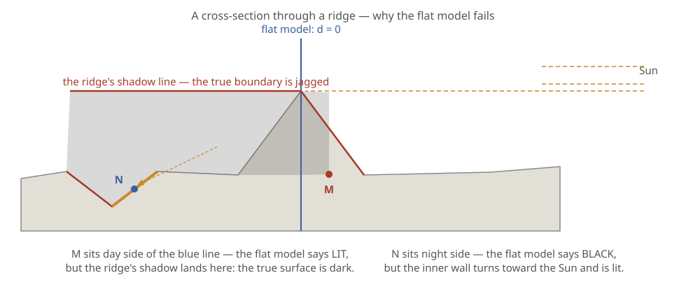

The lighting model
==================

The lighting model answers one question per pixel: *how much sunlight
reaches this point of the surface, toward the viewer?* The answer has to
be good enough that the terminator — the line between day and night —
looks like the ragged, mountain-shadowed edge in NASA's frames, not a
smooth mathematical arc. That is what separates a physically rendered
moon from a shaded circle.

The short version
-----------------

The picture on the panel is not a stored photo — it is computed, pixel
by pixel, on the device. Every pixel goes through the same recipe, and
the recipe has just five ingredients:

1. **Find the point.** Work out which spot on the Moon's ball the pixel
   is looking at.
2. **Ask how directly the Sun hits it** — as if the Moon were a perfect
   ball with no mountains.
3. **Correct for the local tilt.** The real surface has mountains and
   crater walls; a surface tilted *toward* the Sun catches more light
   than the ball says, one tilted *away* catches less (and can sit in a
   shadow the ball model knows nothing about). The tilt comes from a
   terrain height map measured by lunar orbiters.
4. **Multiply by the paint.** A sunlit basalt sea is still darker than
   a sunlit highland — the albedo (reflectivity) map supplies that.
5. **Fix the lookups.** Push the raw brightness through a calibrated
   brightness table so it matches NASA's rendered frames, and add the
   faint Earth-reflected glow (*earthshine*) to the night side.

Every section below takes one of these ingredients, says the plain
version first, and then gives the math and the actual code from
``moon_bake.c``. The four input vectors the recipe needs — where the
Sun is (:math:`\mathbf{S}`), where the Earth is (:math:`\mathbf{E}`),
and the screen's :math:`\mathbf{right}`/:math:`\mathbf{up}` axes — are
built on the previous page, :doc:`the geometry <geometry>`.

Vocabulary
----------

Seven terms carry the whole page (the full definitions live in the
:doc:`glossary <../glossary>`):

- **Terminator** — the day/night boundary line on the visible disk.
- **Albedo** — how much light the surface material itself reflects: a
  dark lava sea has low albedo, a bright highland rock high. It is the
  Moon's *paint*, independent of lighting.
- **Surface normal** — an arrow standing straight up out of the surface
  at a point. How much sunlight a patch catches depends on the angle
  between this arrow and the Sun's direction.
- **Dot product** — the vector multiply ``A · B`` of two unit arrows.
  It equals the cosine of the angle between them: ``1`` when they point
  the same way, ``0`` at right angles, negative when they point apart.
  It is how "how directly does the surface face the Sun?" gets computed
  with three multiplies and two adds.
- **Lambert** (Lambert's cosine law) — a surface's brightness is
  proportional to how directly it faces the light:
  ``L = max(0, cos(angle to the Sun))``. Surfaces facing away are dark.
- **DEM / gradient** — the *Digital Elevation Model*: a map of surface
  heights in meters (here: laser-altimeter data from the LOLA
  instrument). Its **gradient** at a point is the pair of numbers
  saying how fast the ground rises going east, and going north — the
  local slope, in two numbers.
- **LUT** — a *Look-Up Table*: a fixed array of numbers, here
  256 of them, where entry ``n`` says "turn raw value ``n`` into display
  brightness ``T[n]``". One array read replaces a whole curve
  evaluation.

The orthographic view
---------------------

**The short version.** The pixel grid is a flat shadow of the ball. A
pixel's position in the disk (measured from the center, in units of the
disk radius) says exactly which point of the sphere sits behind it —
the farther from the center, the more the surface has curved away from
the viewer. The only geometry needed is the Pythagorean theorem.

The camera is, for our purposes, at infinity: it is 384,400 km away and
the Moon's radius is 1,737 km, so the view is effectively **orthographic**.
Every screen pixel :math:`(x, y)` maps to a unit direction
:math:`\hat{\mathbf{r}}` on the Moon's base sphere (the sphere *without*
relief), built from the camera basis:

.. math::

   \hat{\mathbf{r}} = u\,\mathbf{right} + v\,\mathbf{up} + w\,\mathbf{E},
   \qquad
   w = \sqrt{1 - (u^2 + v^2)}

where :math:`u` and :math:`v` are the pixel's offsets from the disk
center in units of the disk radius. Outside the unit circle
(:math:`u^2 + v^2 > 1`) the pixel is off the disk and is black. The
:math:`w` term is the part of the direction that points along the line
of sight — it is what makes the surface curve toward the viewer at the
limb:

.. figure:: ../_graphs/lighting_ortho.svg
   :alt: Orthographic view construction. (a) The pixel's screen offset (u, v) plus the out-of-page component w times E form the base direction. (b) Side view: the pixel sits off the line of sight by angle phi, so w equals cos(phi), 1 at the disk centre and 0 at the limb.
   :figclass: align-center
   :width: 100%

   The orthographic view. (a) The pixel's screen offset builds the base direction: the in-page part is the 2-D offset :math:`(u, v)`, and the missing third component :math:`w\,\mathbf{E}` points at the viewer (out of the page). (b) Side view: the pixel sits off the line of sight by the angle :math:`\varphi`; :math:`w = \cos\varphi` is 1 at the disk centre and 0 at the limb — the term that pulls :math:`\hat{\mathbf{r}}` back toward the camera and makes the limb curve.

In the C core, per pixel:

.. code-block:: c
   :caption: components/moon/core/moon_bake.c (bake_px, the base direction)

   float u = ((float)x - c->cx) / c->radius;
   float r2 = u * u + c->v * c->v;
   if (r2 > 1.0f) { c->row[x] = 0; return; }
   float w = sqrtf(1.0f - r2);
   /* Base direction, body frame (pole = +z). */
   float rx = u * g->right[0] + c->v * g->up[0] + w * g->E[0];
   float ry = u * g->right[1] + c->v * g->up[1] + w * g->E[1];
   float rz = u * g->right[2] + c->v * g->up[2] + w * g->E[2];
   float d  = rx * g->S[0] + ry * g->S[1] + rz * g->S[2];

The dot :math:`d = \hat{\mathbf{r}}\cdot\mathbf{S}` is the **base-sphere**
sub-solar cosine — plain-language: *"how directly does the perfect ball,
at this point, face the Sun?"* On a perfect sphere with no relief, the lit/dark
terminator is exactly :math:`d = 0`, and the Lambert term would be
:math:`\max(0, d)`. That is the cheap model — and it is *wrong* in exactly
the place it matters: the terminator.

Why the flat model fails at the terminator
------------------------------------------

**The short version.** The Moon has mountains. Right at the day/night
line the Sun skims the surface almost sideways, so a ridge a few
kilometers tall casts a long visible shadow into the valley behind it —
and a crater's inner wall can catch sunlight while its floor stays
dark. A model that ignores the terrain paints those spots the wrong
color, and the eye reads the difference instantly as a "cartoon moon".

The real surface is not a sphere. A mountain ridge standing at the
terminator throws a shadow: the sunlit face of the ridge is bright while
the valley behind it, only a few kilometers away, is in shadow. A
crater's inner wall can be sunlit while its floor is dark. At the
terminator, where the Sun grazes the surface, these effects are maximal
— which is why NASA's frames show a *jagged* terminator that hugs
crater rims and mountain chains, and a smooth cosine terminator would
show none of that.

The fix is to give every surface point its **own normal**, displaced from
the base-sphere normal by the local slope, and take the Lambert with that
normal. That is the **displaced-normal** model.

   Why the flat model fails, in one cross-section. The flat model's terminator is the straight line :math:`d = 0` (blue); the true lit/dark boundary (red) is jagged. M sits *day* side of the flat line but in the ridge's cast shadow — the flat model calls it lit, the true surface is dark. N sits *night* side of the flat line, but its inner wall turns toward the Sun — the flat model calls it black, the true surface is lit. These are exactly the jagged-edge details NASA's frames show.

The displaced-normal Lambert
----------------------------

**The short version.** Instead of asking how the *ball* faces the Sun,
ask how the *actual tilted ground* faces it. The ground's tilt at each
point is read from the terrain height map (two slope numbers per map
cell: how fast the ground rises eastward, how fast northward). Tilt the
"straight up" arrow by that slope, take the dot product with the Sun,
and you get the honest brightness — which is exactly what the one
division in the formula below does.

For a height field :math:`h` on the sphere, a point's true surface normal
is the base-sphere normal displaced by the height gradient. Let
:math:`\mathbf{G}` be the gradient of :math:`h/R` (height in meters
divided by the Moon's radius, so it is dimensionless) in the local
east–north tangent basis. The exact radial-displacement normal is

.. math::

   \mathbf{N} = \mathrm{normalize}\big((1 + s)\,\hat{\mathbf{r}} - \mathbf{G}\big),
   \qquad s = h/R

and the Lambert is :math:`\mathbf{N}\cdot\mathbf{S}`. Working the
normalization out, the dot becomes a ratio that needs no explicit
normalization — and for the small slopes the Moon actually has
(<< 0.3 rad), the **small-slope form** is accurate to under 0.5%:

.. math::

   \mathbf{N}\cdot\mathbf{S} = \frac{\hat{\mathbf{r}}\cdot\mathbf{S} - \mathbf{G}\cdot\mathbf{S}}{\sqrt{1 + \lVert\mathbf{G}\rVert^2}}
   = \frac{d - \mathbf{G}\cdot\mathbf{S}}{\sqrt{1 + |\mathbf{G}|^2}}

Reading the formula piece by piece: ``d`` is the ball's answer from the
previous section; ``G · S`` subtracts the extra (or missing) sun facing
the slope provides; the square root merely re-scales the tilted arrow
back to unit length (it barely moves at real slopes — which is why the
cheap approximation is safe).

The C core calls the unclipped quantity :math:`lns`:

.. code-block:: c
   :caption: components/moon/core/moon_bake.c (the displaced-normal term)

   float gs = glon * east_s + glat * north_s;
   lns = (d - gs) / sqrtf(1.0f + glon * glon + glat * glat);

The lit-side Lambert is then the clip:

.. math::

   L = \mathrm{clip}(lns,\, 0,\, 1)

and the *unclipped* :math:`lns` is kept around because the dark side
(:doc:`the dark side <darkside>`) needs :math:`\mathrm{clip}(-lns, 0, 1)` — the same surface
lit from the anti-solar direction.

.. figure:: ../_graphs/lighting_displaced_normal.svg
   :alt: The displaced-normal construction. (a) A point on a flank sloping toward the grazing Sun: the flat model's radial normal reads d about 0.07, the slope-tilted true normal reads lns about 0.22. (b) The small-slope form: lns = (d minus G dot S) over the square root of (1 plus the squared norm of G), accurate to under 0.5% at the Moon's real slopes.
   :figclass: align-center
   :width: 100%

   The displaced-normal construction. (a) A point on a flank that slopes toward the grazing Sun: the flat model takes the radial (straight-up) normal and reads :math:`d \approx 0.07` (barely lit); the true normal, tilted by the local slope :math:`\mathbf{G}`, reads :math:`lns \approx 0.22` — three times brighter, and the difference is the ridge-shadow contrast the flat model cannot see. (b) The small-slope form worked out: :math:`lns = (d - \mathbf{G}\cdot\mathbf{S}) / \sqrt{1 + \lVert\mathbf{G}\rVert^2}` needs no explicit normalization, and is accurate to under 0.5% at the Moon's real slopes.

The model is applied over the **whole lit disk**, not just the terminator
band. An earlier version blended a clipped relief term only in a thin
band around :math:`d=0` (a compute shortcut); it left the terminator
3–7× too soft, because the mountain shadows extend well into the lit
side. The current full-disk displaced-normal model is what matches NASA's
terminator contrast.

The relief DEM and its gradient cache
-------------------------------------

**The short version.** All the terrain knowledge lives in one height
map downloaded from lunar orbiters. The bake doesn't need the heights
themselves — only how steep the ground is, in two numbers per point.
Computing the steepness fresh for every screen pixel is six separate
reads from the ESP32-S3's slow external RAM (PSRAM), which measured at
~3.3 s per frame. But steepness depends only on the height map, not on
the Moon's phase — so the device computes it **once** for every map cell
at boot, packs the two slope numbers into one 16-bit word, and the
bake reads just one word per pixel. That drops the frame time to
~1.3 s.

The height data is the **LOLA** (Lunar Orbital Laser Altimeter) DEM,
stored on the clock boards as a **2048×1024 int8** equirect map (the
knob's is the halved 1024×512 — the per-board sizes are
:doc:`the moon constants <../reference/moon-consts>`). Each cell is
the LOLA height quantized to 8 bits over a fixed meter range:

.. code-block:: c
   :caption: components/moon/generated/<board>/moon_consts.h (the relief DEM)

   // LOLA height quantized to int8 over [MOON_DEM_MIN, MOON_DEM_MAX] meters:
   // code = round((h - MIN) / (MAX - MIN) * MOON_DEM_STEPS) - 128.
   #define MOON_DEM_W      2048
   #define MOON_DEM_H      1024
   #define MOON_DEM_STEPS  254
   #define MOON_DEM_MIN_M  -8518.19921875
   #define MOON_DEM_MAX_M  10416.568359375

The bake needs the *gradient* of this map, not the heights. The naive
approach — a 4-neighbor central-difference gather per pixel — is six
dependent PSRAM loads per pixel, which on the S3 (the Waveshare
ESP32-S3-Touch-AMOLED-1.75) measured at ~3.3 s/frame.
The key optimization (:doc:`the C core <../implementation/core-c>`) is to **precompute the gradient once,
per DEM cell**, into a packed cache:

.. code-block:: c
   :caption: components/moon/core/moon_bake.c (relief_cell, the cache entry)

   float dhlon = ((float)row_m[c + 1] - (float)row_m[c - 1]) * mps;  // east-west slope
   float dhlat = ((float)row_n[c]     - (float)row_s[c])     * mps;  // north-south slope
   int8_t qn = slope_q(dhlon * inv_glon), qt = slope_q(dhlat * inv_glat);
   gpack[c] = (uint16_t)((uint16_t)(uint8_t)qn | ((uint16_t)(uint8_t)qt << 8));

What that code does line by line, for a new reader: the east-west slope
starts as "the height one cell east, minus the height one cell west"
(likewise north-south). The stored bytes first become meters — the full
height range is spread over 254 quantization steps, and the ``mps``
factor is the meters-per-step decoder. The height difference is then
divided by the ground distance those cells cover on the sphere;
``inv_glon``/``inv_glat`` are those reciprocals, and the east-west one
carries the ``rho`` = cos(lat) factor, because a cell of longitude
narrows toward the poles and the same height difference then means a
steeper slope. Each slope is then rounded to a single signed byte
(quantization step 0.003 rad) and the two bytes are packed low-and-high
into one 16-bit word.

Each cache cell packs the quantized east (glon) and north (glat) slopes
into a single 16-bit word (one in the low byte, one in the high byte).
The bake then reads **one** 16-bit load per pixel instead of six
dependent byte loads — dropping the per-pixel PSRAM traffic from 6 to 3
(1 albedo byte + 1 packed 2-byte gradient + the texture-coordinate math)
and cutting the frame time to ~1.3 s on the S3. The quantization step
(0.003 rad) costs less than 0.3% of :math:`L`, and the image gate
(:doc:`the image gate <../verification/image-gate>`) re-verifies it after any change.

The slopes are a *pure function of the DEM cell* — the four-neighbor
height differences — so the cache is phase-independent: it is built once
at boot and reused for every frame. That is what made the boot sweep
(1344 frames, retired :commit:`51119200`) and the dusk's map build (retired
the same day, :commit:`f7740500`) affordable — and what keeps the
orbit re-bakes cheap.

The tangent basis
-----------------

**The short version.** "Slope east" and "slope north" are only
meaningful once you draw an east arrow and a north arrow on the sphere
at that exact point — the two arrows that lie flat on the surface there.
Instead of computing the point's latitude and longitude and calling
trigonometry on them, the core builds those two arrows directly from
the direction vector it already has, with one square root.

The gradient :math:`\mathbf{G}` lives in the local east–north tangent
plane of the unit sphere. Those two unit vectors are built from the base
direction :math:`\hat{\mathbf{r}} = (rx, ry, rz)` itself — no
longitude/latitude transcendentals needed:

.. math::

   \text{east}  = \frac{(-ry,\; rx,\; 0)}{\rho}, \qquad
   \text{north} = \frac{(-rz\,rx,\; -rz\,ry,\; \rho)}{\rho}, \qquad
   \rho = \sqrt{rx^2 + ry^2} = \cos(\text{lat})

and only the *dots with* :math:`\mathbf{S}` are needed, which the core
computes directly:

.. code-block:: c
   :caption: components/moon/core/moon_bake.c (tangent dots with the Sun)

   float rho = sqrtf(rx * rx + ry * ry);   /* = cos(lat) */
   if (rho < 1e-4f) rho = 1e-4f;
   float inv = 1.0f / rho;
   float east_s  = (-ry * g->S[0] + rx * g->S[1]) * inv;
   float north_s = (-rz * rx * g->S[0] - rz * ry * g->S[1] + rho * g->S[2]) * inv;

The :math:`\rho < 10^{-4}` guard is the polar cap, where the east–north
basis degenerates (there, :math:`lns \to 0` anyway, so the guard is
inert).

Albedo, nearest-neighbor
------------------------

**The short version.** Lighting says *how much* light; the albedo map
says *how much of it the ground bounces back*. The map carries roughly
one texture pixel per screen pixel on the disk *on average*, and the
nearest-neighbour pick can at worst mis-choose by half a texture pixel
— under one screen pixel on every board and every source — so there is
no detail to lose by simply picking the nearest texture point, and no
interpolation math to pay for it. (The Xtensa FPU has no
``atan``/``asin`` at all, so even the "which map point is this?"
question is answered with a tiny lookup table.)

The color is the **LROC WAC** albedo — an equirect map, 864×432 on
the S3 and the knob, 2048×1024 on the P4 (row 0 = north, column 0 =
the texture longitude 0, with the 180° offset from
:doc:`the geometry <geometry>`). The Xtensa FPU has no ``atan``/``asin``, so the texture
longitude/latitude come from two small 257-entry internal-RAM lookup
tables (worst-case error << one texture row) rather than libm calls.
The albedo is sampled **nearest-neighbor**, and the guarantee behind
that is the half-texel **pick error**, not the density: the disk-averaged
density is 1.08 texels per screen pixel on the S3 (864 columns over the
400 px disk) and 1.58 on the P4, but the orthographic worst case sits at
the disk centre, where the S3 albedo dips to 0.69 — and the pick still
never moves a feature by more than half a texel, i.e. ≤ 0.73 px (the
relief caches, the P4 pair and the knob pair land between 0.31 and 0.55
px). :ref:`The resolution funnel <sharpness-funnel-perf>` in the
performance page plots all six source legs with their parsed widths;
the bake's header comment cites it directly. The sampling itself costs
one byte load.

.. code-block:: c
   :caption: components/moon/core/moon_bake.c (albedo sample)

   float colf = (theta + MOON_TEX_LON_OFFSET) * c->per_deg;
   if (colf >= (float)c->alb_w) colf -= (float)c->alb_w;
   int col = (int)(colf + 0.5f);
   int r   = (int)(row_frac * (float)c->alb_h + 0.5f);
   float A = (float)c->alb[r * c->alb_w + col];

Earthshine (the validated dark-side model)
------------------------------------------

**The short version.** The night side of the Moon is not pitch black:
sunlight bounces off the Earth and faintly backlights it (the same
effect that lets you sometimes see the unlit crescent in a photograph).
The model adds a deliberately faint glow to the dark half that grows
with distance from the terminator toward the anti-solar point — three
tuned numbers in a cubic polynomial, fitted so the result matches
NASA's reference frames.

With :math:`dark_zero = 0` — the path the image gate validates — the
dark side is not flat black. It carries a faint, **phase-independent**
anti-solar gradient, a fit to the reference frames' Earthlight. It is a cubic in :math:`x = \max(0, -d)`:

.. code-block:: c
   :caption: components/moon/core/moon_bake.c (earthshine)

   static inline float earthshine(float d) {
       float x = -d > 0.0f ? -d : 0.0f;
       return MOON_ES_A * x + MOON_ES_B * x * x + MOON_ES_C * x * x * x;
   }

.. code-block:: c
   :caption: components/moon/generated/<board>/moon_consts.h (earthshine coefficients)

   #define MOON_ES_A 30.455
   #define MOON_ES_B -11.733
   #define MOON_ES_C -2.615

The constants are fitted (``python -m moon.validate --fit``) so the dark
side matches the reference's faint gradient. This is the *physics*
dark side. The *display* dark side — the computed backlit surface — is
the subject of :doc:`the dark side <darkside>`; the artistic pass that made the dark side read
as a real moon is :doc:`the artistic pass <art-pass>`.

.. figure:: ../_static/figs/earthshine.png
   :alt: The fitted earthshine cubic with the device constants: zero at the terminator (x = 0), peaking at only about 16 grey levels at the centre of the night disk (x = 1).
   :figclass: align-center
   :width: 72%

   The fitted earthshine cubic with the device constants (``moon_consts.h``). It peaks at only ~16 grey levels at the dark-side centre (:math:`x = 1`) — deliberately faint. :math:`x = 0` at the terminator, :math:`x = 1` at the centre of the night disk.

The tone LUT
------------

**The short version.** The raw physics number (paint × sunlight, 0–255)
does not *look* like NASA's rendered frames, which were themselves
beautified. Rather than invent a curve, the project stores a 256-entry
table — one entry per possible raw brightness — that says exactly what
display value each raw value should become, fitted to the reference. A
pixel's final brightness is one table read plus the earthshine.

The raw product is :math:`A \cdot L` (albedo times the lit-side
Lambert), in 8-bit units. The reference frames are "optimized for
aesthetics" — their brightness is not the raw physical
:math:`\text{albedo}\times L`, it has a gamma and a highlight
compression applied. Rather than fit a per-pixel curve, the project
freezes a **256-entry 8-bit tone LUT** that maps the raw
:math:`\text{albedo}\cdot L` index to the reference's brightness:

.. figure:: ../_static/figs/tone_lut.png
   :alt: The shipped 256-entry tone LUT: display brightness (y) against the raw albedo-times-L index (x). Bin 0 is 0, and the tail is not monotonic past about 220, so the brightest floors roll off rather than pinning at 255.
   :figclass: align-center
   :width: 72%

   The shipped 256-entry tone LUT (``tone_lut.bin``), raw :math:`\text{albedo}\times L` index (x) against display brightness (y). Two load-bearing properties are visible: **bin 0 is 0** (no sunlight → the LUT contributes nothing; only earthshine remains), and the **tail is not monotonic past ~220** — the brightest crater floors and mare lowlands compress and dip slightly rather than pinning at 255, matching the reference's highlight rolloff.

.. code-block:: c
   :caption: components/moon/core/moon_bake.c (the final pixel)

   int idx = (int)(A * L + 0.5f);
   if (idx < 0) idx = 0; else if (idx > 255) idx = 255;
   float out = MOON_TONE_LUT[idx] + earthshine(d);
   c->row[x] = (uint8_t)(out < 0.0f ? 0.0f : (out > 255.0f ? 255.0f : out + 0.5f));

Two properties of the LUT are worth noting. **Bin 0 is 0**: a pixel with
no sunlight (:math:`L = 0`) gets no contribution from the LUT — its
brightness is the earthshine alone, which is what keeps the pure dark side
consistent. The tail is *not* monotonic past ~220: the LUT was fit to the
reference's highlight rolloff, so the brightest crater floors and mare
lowlands compress and can dip slightly rather than pin to 255. That
non-linearity is why the backlit dark side (:doc:`the dark side <darkside>`) uses a *linear*
gray instead of the LUT — running the faint dark side through a LUT
tuned for the lit side would over-brighten it.

The full per-pixel model, assembled
-----------------------------------

Here is the five-ingredient recipe from the top of the page again, now
as the exact ten steps the code takes. Everything above was a detour
into one of these lines; everything below is the same, in one place.
One lit pixel is:

.. code-block:: text
   :caption: The complete per-pixel bake (lit side)

   1. u, v       = pixel offset from disk center, in radius units
   2. w          = sqrt(1 - u^2 - v^2);            r2 > 1 -> 0 (off disk)
   3. r_hat      = u*right + v*up + w*E            (body-frame direction)
   4. d          = r_hat . S                       (base-sphere sub-solar)
   5. (glon,glat)= packed gradient cache cell      (precomputed relief slope)
   6. lns        = (d - G.S) / sqrt(1 + |G|^2)     (displaced-normal Lambert, unclipped)
   7. L          = clip(lns, 0, 1)                 (lit-side Lambert)
   8. A          = albedo(theta + 180, row_frac)   (nearest-neighbor)
   9. idx        = round(A * L)
   10. out       = TONE_LUT[idx] + earthshine(d)   (8-bit)

Every step is a few FPU ops plus byte/word loads from PSRAM. The next
page shows what happens to the pixels where :math:`lns \le 0` — the
dark side, which is where this product made its most deliberate choices.

.. figure:: ../_static/figs/bake_pipeline.png
   :alt: One frame through the whole bake pipeline, eight intermediate maps of a waning gibbous at 466 by 466: the base-sphere cosine d, the displaced-normal result lns (ragged terminator), the clipped lit side L, the unlit albedo A, the raw A-times-L product idx, the tone-mapped LUT, the earthshine term es (exaggerated 8x), and the final out the device shows.
   :figclass: align-center
   :width: 100%

   One frame through the whole pipeline — each panel is the actual
   intermediate result at one step of the 10-line model above (a waning
   gibbous, 466×466, the same code the Moon Lab
   simulator runs). :math:`d`: the smooth base-sphere cosine.
   :math:`lns`: the displaced-normal result — the terminator is now
   ragged, and the dark side is not perfectly flat. :math:`L`: the clip
   — the dark side is hard black, but the lit side keeps the ridge
   shadows. :math:`A`: the albedo, unlit. :math:`idx`: the raw
   :math:`A\cdot L` product. :math:`\mathrm{LUT}`: the tone-mapped
   brightness. :math:`\mathrm{es}`: the earthshine added to the dark
   side (exaggerated ×8 for visibility — it is a ~16-grey-level
   gradient). :math:`\mathrm{out}`: the final pixel the device shows.

The figure is generated from the same code the reader drives:
``node docs/tools/gen_bake_intermediates.js`` dumps the eight
intermediate maps, ``docs/tools/gen_bake_strip.py`` lays them out.

To put the model through its own paces — change the phase, the date, the
camera, and watch each intermediate — see :doc:`the interactive
simulator <interactive>`.
