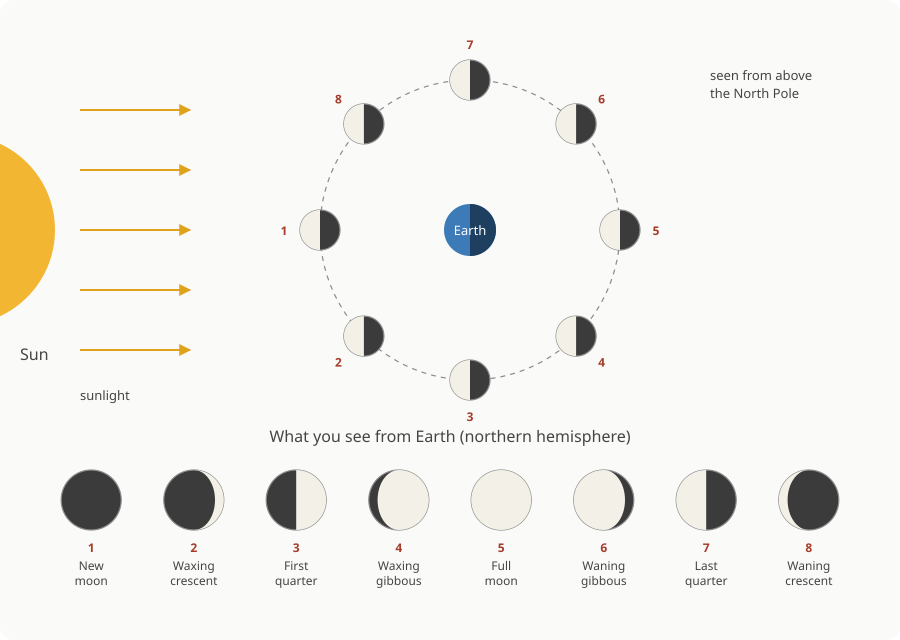

Draw the Moon on your computer
==============================

.. brief:
   Reader: anyone curious, with or without a board.
   They already know: how to type commands into a Linux terminal.
   After this page they can: draw tonight's Moon, or the Moon on any
   date, with the clock's own code.
   Page type: tutorial.

In this tutorial you run the clock's Moon drawing code on your own
computer, without any board. You draw the Moon as it looks tonight,
then a whole month of phases. It takes about 15 minutes.

The program you build, ``moon_sim``, contains exactly the same C code
that runs on the clock. Only the screen is replaced by a PNG file.

What you need
-------------

- a Linux computer with ``git``, ``git-lfs``, ``cmake``, ``gcc`` and
  ``python3``. On Debian or Ubuntu:

  .. code-block:: bash

     sudo apt-get install git git-lfs cmake gcc python3 python3-venv

- about 1 GB of free disk space, mostly for the NASA maps.

1. Get the project
------------------

.. code-block:: bash

   git lfs install
   git clone https://github.com/ukos-git/moon-clock-esp.git moon-phase
   cd moon-phase

2. Prepare the Moon maps
------------------------

.. code-block:: bash

   python3 assets/images/moon/get_assets.py

The script checks the NASA maps that came with the project and shrinks
them to the size the clock uses. The first run sets up a Python
environment and takes a few minutes.

3. Build the simulator
----------------------

.. code-block:: bash

   cmake -S host_sim -B host_sim/build
   cmake --build host_sim/build

This builds the simulator for the main board's map size. When it
finishes, ``host_sim/build/moon_sim`` exists.

4. Draw tonight's Moon
----------------------

.. code-block:: bash

   mkdir -p ~/moon
   host_sim/build/moon_sim --utc "$(date -u +%Y-%m-%dT%H:%M)" --darkzero --out ~/moon

The program prints one line, for example::

   /home/you/moon/sim.png  utc=2026-11-27T20:00  rot=0  phase=85.35%  ss=(-41.39,-1.37)

Open ``~/moon/sim.png``. You see a 400 × 400 pixel Moon with north at
the top. ``phase`` is the lit fraction of the disk: 85.35 % here, a
few days after full moon. ``--darkzero`` draws the night side the way
the clock shows it, faintly lit, so the craters stay visible. Leave it
out to get a dark night side like NASA's reference images.

   Compare your picture with the phases. A Moon lit on the left, as
   seen from the northern hemisphere, is waning.

5. Draw a month
---------------

Ask for eight pictures spread evenly over one month, from the new
moon of 9 December 2026 to the next one:

.. code-block:: bash

   mkdir -p ~/moon/month
   host_sim/build/moon_sim --frames 8 --start 2026-12-09T12:00 \
       --end 2027-01-07T12:00 --darkzero --out ~/moon/month

The folder now holds ``sim.0000.png`` to ``sim.0007.png``. Flip
through them: the lit part grows from the right, becomes full around
24 December, and shrinks again until only the left edge is lit. Look
near the edges too. The craters close to the rim shift slightly from picture to picture; that is the wobble called
libration (:doc:`How the clock works <how-it-works>`).

Try a date you remember, such as your birthday, with ``--utc``.

What you built
--------------

You compiled the clock's portable Moon library for your PC and used
it to compute the Moon for any moment, from the same NASA maps the
clock carries. The automated NASA comparison, :doc:`the image gate
<verification/image-gate>`, uses this same program.

Where to go next
----------------

- :doc:`How the clock works <how-it-works>` explains what the program
  computes.
- :doc:`Getting started <getting-started>` puts the same code on a real
  board.
- :doc:`The portable C core <implementation/core-c>` explains the code
  you just built, and :doc:`the build system <reference/build-system>`
  lists the simulator's other options, including the full-screen
  simulator that renders every settings screen.
